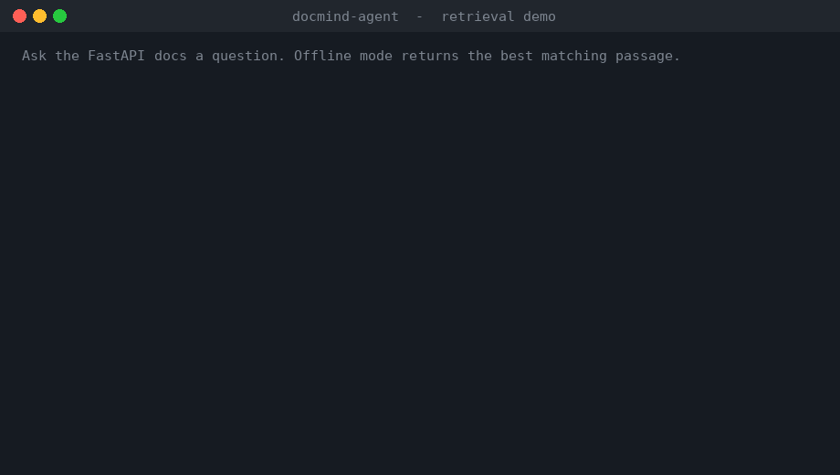
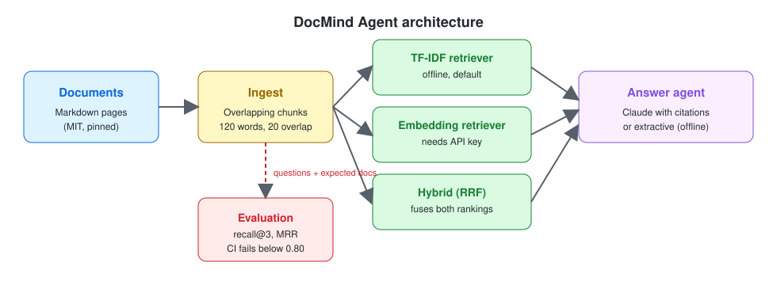
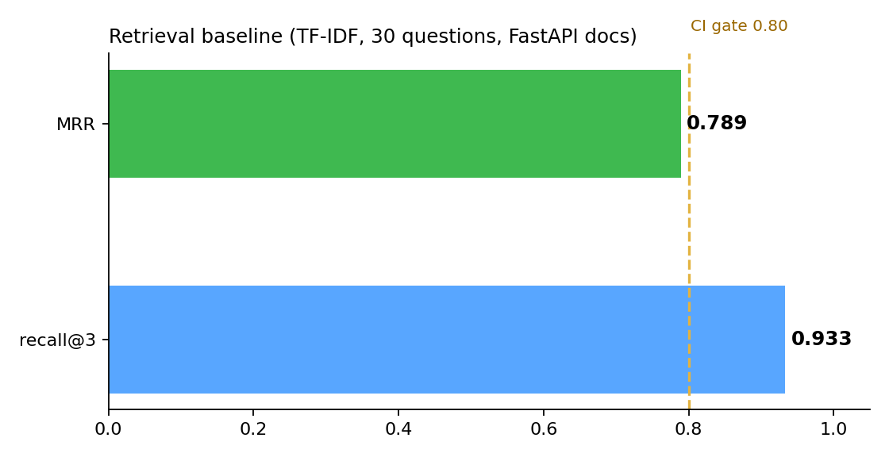

# DocMind Agent

**Ask questions about a document set and get answers you can verify.**
DocMind retrieves the most relevant passages, cites where each answer came from, and runs a retrieval evaluation in CI so quality regressions fail the build.

[](https://github.com/Siddique-SID/docmind-agent/actions/workflows/ci.yml)




## Highlights
- **Cited answers.** Every response lists the document and chunk it came from.
- **Works offline.** The default TF-IDF retriever needs no API key or paid service.
- **Switchable retrieval.** TF-IDF, dense embeddings, or hybrid search, selected with one environment variable.
- **Measured, not guessed.** A labelled evaluation set reports recall@k and MRR, and CI blocks merges below the threshold.
- **Grounded generation.** With an API key, Claude answers only from retrieved context and says when the answer isn't there.

## Architecture


Documents are split into overlapping chunks and indexed by one of three retrievers. The answer layer either returns the best passage (offline) or asks Claude to answer from the retrieved context. The evaluation harness runs the same retrievers against labelled questions.

## Results
Retrieval quality on 30 paraphrased questions over 29 FastAPI documentation pages (MIT licensed, pinned to a fixed commit so numbers are reproducible).

| Version | Retriever | Recall@3 | MRR | Notes |
|---|---|---|---|---|
| v0.3 | TF-IDF (default) | **0.933** | 0.789 | Offline baseline. Misses: multi-parameter request bodies, UUID/date fields |
| v0.4 | Embedding | pending | pending | Needs `OPENAI_API_KEY` |
| v0.4 | Hybrid (RRF) | pending | pending | Needs `OPENAI_API_KEY` |



Questions are paraphrased from the documents rather than copied, so keyword overlap alone doesn't guarantee a hit.

## Quickstart
```bash
git clone https://github.com/Siddique-SID/docmind-agent.git
cd docmind-agent
python -m venv .venv && source .venv/bin/activate
pip install -r requirements.txt

python scripts/fetch_corpus.py                     # download the pinned FastAPI docs
PYTHONPATH=src pytest -q                           # unit tests
PYTHONPATH=src python eval/run_eval.py             # retrieval evaluation
PYTHONPATH=src uvicorn docmind.api:app --reload    # API at http://127.0.0.1:8000/docs
```

Ask a question:
```bash
curl -s http://127.0.0.1:8000/ask \
  -H "Content-Type: application/json" \
  -d '{"question": "How do I customise the API title and version?"}'
```

Docker:
```bash
docker build -t docmind-agent .
docker run -p 8000:8000 docmind-agent
```

## Choosing a retriever
Set `DOCMIND_RETRIEVER` to one of:

| Mode | Needs | How it works |
|---|---|---|
| `tfidf` (default) | nothing | Lexical TF-IDF similarity |
| `embedding` | `OPENAI_API_KEY` | Dense vectors from `text-embedding-3-small` (override with `DOCMIND_EMBED_MODEL`) |
| `hybrid` | `OPENAI_API_KEY` | Reciprocal rank fusion of the TF-IDF and embedding rankings |

```bash
DOCMIND_RETRIEVER=hybrid OPENAI_API_KEY=... PYTHONPATH=src python eval/run_eval.py
```

To enable Claude-generated answers, set `ANTHROPIC_API_KEY`. Without it, the API returns the best matching passage and marks the response `"mode": "extractive"`.

## Design decisions
- **Evaluation before features.** The labelled set and CI gate exist before the embedding work, so every retrieval change is measured against the same baseline.
- **Pinned corpus.** The FastAPI docs are downloaded from a fixed commit by `scripts/fetch_corpus.py`, so results don't drift when upstream docs change.
- **Offline default.** CI and local development need no secrets, which keeps the pipeline reliable for forks and contributors.
- **Honest answers.** The generation prompt restricts answers to retrieved context and asks the model to say when the context doesn't contain the answer.

## Known limitations
- Offline mode returns the best matching passage, not a synthesised answer, so it can include surrounding markup or an off-topic passage. Use the LLM mode for clean answers.
- TF-IDF misses questions whose wording shares few keywords with the source page. The two current misses show this.
- The evaluation set is 30 questions over one corpus. It's a useful signal, not a general benchmark.

## Roadmap
- [x] TF-IDF baseline with evaluation and CI gate
- [x] Embedding and hybrid retrievers (code complete, scores pending)
- [ ] Reranking step with before/after metrics
- [ ] Answer-level evaluation (correctness and faithfulness)
- [ ] MCP server exposing `search_docs` as a tool
- [ ] Cost and latency tracking per query
- [ ] Deployed demo

## Project layout
```
src/docmind/   core package: ingest, retrieve, agent, api
eval/          labelled questions and evaluation script
scripts/       corpus download script
data/sample/   example documents used by the unit tests
tests/         unit tests
docs/assets/   demo, diagram and charts for this README
.github/       CI workflow
```

## License
MIT. See [LICENSE](LICENSE). The evaluation corpus is FastAPI documentation, also MIT licensed.
